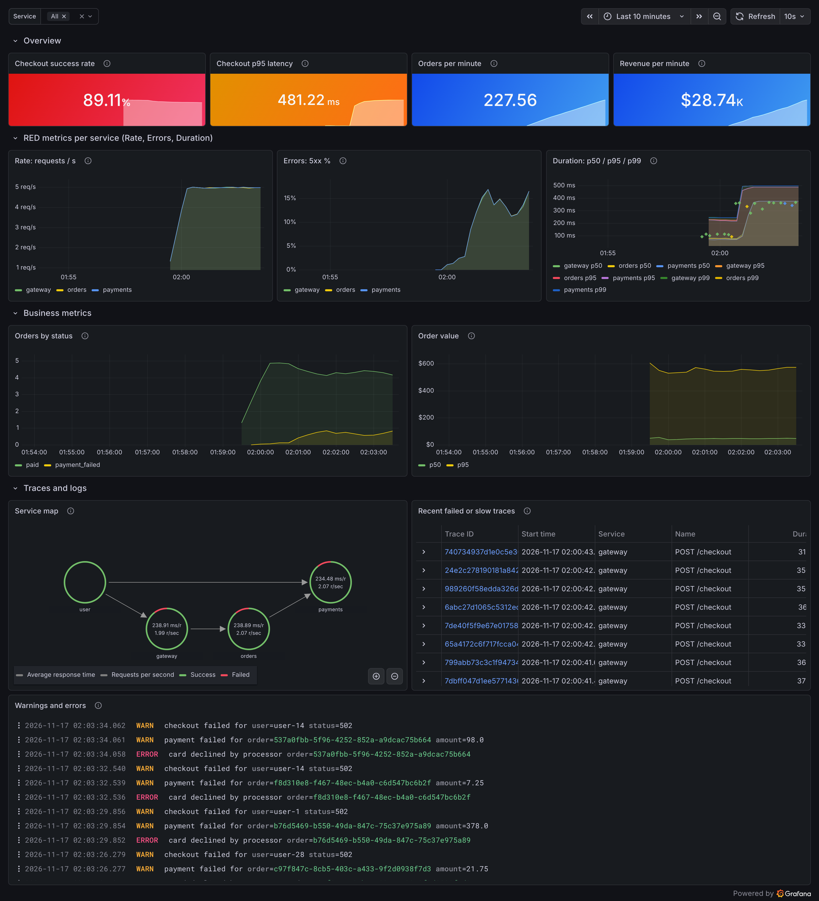
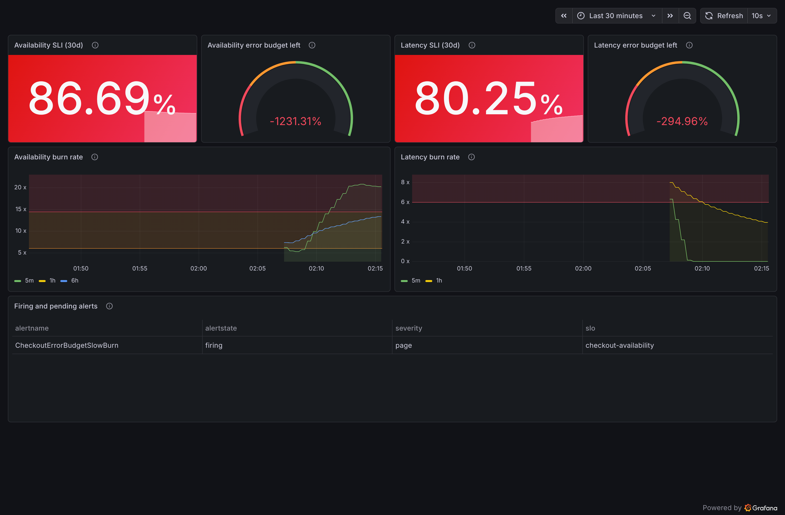

# Learning notes

This file grows with each step of the project. Each section explains what was
built, why it was built that way, and the ideas you need to build it yourself.

## Contents

1. [Step 1: Three services and Docker Compose](#step-1-three-services-and-docker-compose)
2. [Step 2: OpenTelemetry and the Collector](#step-2-opentelemetry-and-the-collector)
3. [Step 3: Prometheus, Tempo, Loki and Grafana](#step-3-prometheus-tempo-loki-and-grafana)
4. [Step 4: SLOs, alerts and chaos scenarios](#step-4-slos-alerts-and-chaos-scenarios)
5. [Step 5: Professional code quality and CI](#step-5-professional-code-quality-and-ci)

---

## Step 1: Three services and Docker Compose

### What we built

A tiny online shop split into three small programs ("microservices"):

```
 you / loadgen
      |
      v
  gateway  :8080      checks the request, forwards it
      |
      v
   orders             creates the order, asks payments to charge
      |
      v
  payments  :8082     pretends to charge a card (and can be told to fail)
```

Plus a **load generator** that plays the role of users, and a
`docker-compose.yml` that starts all four with one command.

| File | What it does |
|---|---|
| `services/gateway/main.py` | `POST /checkout`. Validates input, calls orders. |
| `services/orders/main.py` | `POST /orders`. Computes the amount, calls payments, stores the order. |
| `services/payments/main.py` | `POST /payments`. Sleeps 20-120 ms, fails 2% of the time. `POST /chaos` changes that. |
| `services/Dockerfile` | One Dockerfile for all three services. |
| `loadgen/loadgen.py` | Sends N checkout requests per second, forever. |
| `docker-compose.yml` | Starts everything on a private network. |

### Why it is designed this way

**Why three services and not one?** Observability matters most when one user
request crosses several programs. If checkout is slow, you need to know
*which* service is slow. With a single program you would never need traces.
The chain gateway -> orders -> payments is the smallest setup that makes
distributed tracing worth showing.

**Why a "chaos" switch?** A healthy system gives flat, boring graphs. To prove
your dashboards and alerts work, you need to break things on purpose. Payments
has an error rate and an extra delay you can change while it runs. This idea
is called *chaos engineering* (Netflix made it famous with Chaos Monkey).

**Why a load generator?** Metrics only exist when traffic exists. Real systems
have users; a demo needs fake ones.

**Why FastAPI?** It is short to read, async (handles many requests at once
without threads), validates input from type hints (`quantity: int = Field(gt=0)`
gives you a 422 error for free), and has first-class OpenTelemetry support,
which we use in step 2.

### Key concepts

1. **Microservices talk over HTTP.** Each service is a web server. Orders
   calls payments the same way your browser calls a website: `POST
   http://payments:8000/payments` with a JSON body.

2. **Docker image vs container.** The `Dockerfile` is a recipe. Building it
   gives an *image* (a frozen snapshot of Python + your code). Running an image
   gives a *container* (a live process). We build one image per service.

3. **Layer caching.** In the Dockerfile we copy `requirements.txt` and run
   `pip install` *before* copying the code. Docker caches each step. When you
   only change code, it reuses the cached install and rebuilds in seconds.

4. **Build arguments.** `ARG SERVICE` lets one Dockerfile build three images:
   compose passes `SERVICE: gateway`, `SERVICE: orders`, and so on.

5. **Docker Compose networking.** Compose puts all services on one private
   network, where each service's *name* is its hostname. That is why orders
   can reach `http://payments:8000` without knowing any IP address. Only
   ports listed under `ports:` are reachable from your own machine.

6. **Configuration through environment variables.** URLs and chaos settings
   come from `os.getenv(...)`. The same image can then run on your laptop, in
   tests, or in production with different settings. This is one of the
   "Twelve-Factor App" rules.

7. **Error propagation.** If payments fails, orders returns `502 Bad
   Gateway` ("someone I depend on failed"), and if a service cannot be reached
   at all you get `503 Service Unavailable`. Choosing the right status code
   matters: in step 3 we will count 5xx responses to measure the error rate.

8. **Timeouts.** Every `httpx.AsyncClient` has `timeout=5.0`. Without a
   timeout, one stuck service can make every service that calls it hang too.

### Try it yourself

```bash
docker compose up --build          # start everything
curl -X POST localhost:8080/checkout -H 'content-type: application/json' \
     -d '{"user_id":"u1","item":"mouse","quantity":2,"unit_price":19.5}'

# Break payments: every request fails
curl -X POST localhost:8082/chaos -H 'content-type: application/json' \
     -d '{"error_rate":1.0,"extra_latency_ms":0}'
# Now the checkout call above returns 502. Set error_rate back to 0.02.

docker compose logs -f loadgen     # watch the fake users
```

### What is missing (and why step 2 exists)

Right now, if checkout gets slow, all you can do is read logs from four
containers and guess. There are no numbers over time (metrics), no way to
follow one request across services (traces), and logs are not connected to
anything. Step 2 adds OpenTelemetry to fix exactly that.

---

## Step 2: OpenTelemetry and the Collector

### What we built

Every service now produces the **three signals** of observability and sends
them to an **OpenTelemetry Collector**:

```
 gateway ─┐
 orders  ─┼── OTLP (traces + metrics + logs) ──>  otel-collector  ──> (step 3: Prometheus, Tempo, Loki)
 payments ┘                                       today: prints to its own log
```

| File | Change |
|---|---|
| `services/requirements.txt` | Adds the OpenTelemetry SDK, OTLP exporter and auto-instrumentation packages. |
| `services/Dockerfile` | Starts the app through `opentelemetry-instrument`. |
| `services/*/main.py` | Adds span attributes, one manual span per service, two custom metrics, and log lines. |
| `otel-collector/config.yaml` | The Collector pipeline: receive, process, export. |
| `docker-compose.yml` | Adds the Collector and shared `OTEL_*` settings. |

### The three signals

| Signal | Question it answers | Example here |
|---|---|---|
| **Metrics** | "How much / how often / how fast, over time?" Cheap numbers, aggregated. | `shop.orders` counter split by `status`, request duration histograms. |
| **Traces** | "What happened to *this one* request, step by step, across services?" | One checkout = one trace with spans in gateway, orders and payments. |
| **Logs** | "What exactly did the code say at that moment?" | `payment failed for order=... amount=...` |

The power comes from **connecting** them: a metric shows errors went up, you
click into a trace of a failed request, and from the trace you jump to the
exact log lines (they share the same `trace_id`).

### Why it is designed this way

**Why OpenTelemetry instead of a Prometheus client library?** OpenTelemetry
(OTel) is the vendor-neutral standard. You instrument the code once, and the
data can go to Prometheus, Grafana, Datadog, New Relic, Honeycomb, and so on,
by changing Collector config, not code. That is why every job ad for
observability mentions it.

**Why auto-instrumentation?** `opentelemetry-instrument` patches FastAPI and
httpx at startup. Without writing a line of tracing code we get a span for
every incoming request, a span for every outgoing call, and standard HTTP
metrics (`http.server.duration` etc.). We only add custom code where business
meaning is needed (which user? how much money?).

**Why a Collector in the middle, instead of apps sending straight to
backends?**
- Apps only know one address (`otel-collector:4318`). Swapping a backend
  never touches app code.
- Batching, retries and memory limits live in one place.
- You can add, drop, rename or redact data centrally (for example, remove
  credit-card numbers before they leave your network).

**Why OTLP over HTTP (port 4318) and not gRPC (4317)?** Both work. The HTTP
exporter has fewer dependencies (no `grpcio`, which is large to install), so
images build faster. The Collector listens on both.

### Key concepts

1. **Trace, span, context propagation.** A *trace* is the whole journey of
   one request. A *span* is one step in it, with a start time, a duration, a
   name, attributes and a status. When gateway calls orders, the httpx
   instrumentation adds a `traceparent` HTTP header holding the trace id.
   Orders reads that header and creates its spans *inside the same trace*.
   This is **context propagation** and it is the whole trick behind
   distributed tracing. (The header format is the W3C Trace Context standard.)

2. **Span attributes.** Key/value pairs on a span, like
   `app.user_id=user-7`. In step 3 you will search Tempo for "all traces where
   `app.user_id=user-7`".

3. **Manual spans.** `with tracer.start_as_current_span("price_order"):`
   creates a child span for a block of code you care about. In payments,
   `card_processor.charge` is the span that grows when we turn on chaos
   latency, which makes the slow part obvious in a trace.

4. **Span status.** `span.set_status(Status(StatusCode.ERROR, ...))` marks a
   span as failed so trace viewers show it in red.

5. **Metric instruments.**
   - *Counter*: only goes up (`shop.orders`). You later compute a *rate*
     ("orders per second").
   - *Histogram*: records a distribution (`shop.order.value`). You later ask
     for averages or percentiles (p50, p95, p99).
   - *Attributes* (labels) split one metric into series, like
     `status=paid` vs `status=payment_failed`.
   - **Cardinality warning:** never use unbounded values (user ids, order
     ids) as metric attributes. Each unique value creates a new time series
     and can blow up Prometheus. Put those on spans instead. That is why
     `user_id` is a span attribute but `item` (4 possible values) is a metric
     attribute.

6. **Resource attributes.** Data describing *who* sent the telemetry:
   `service.name`, `service.version`, `deployment.environment`. Set through
   `OTEL_SERVICE_NAME` / `OTEL_RESOURCE_ATTRIBUTES`, and by the Collector's
   `resource` processor.

7. **Log correlation.** `OTEL_PYTHON_LOG_CORRELATION=true` stamps every log
   record with the current `trace_id` and `span_id`. Run the services and you
   will see lines like
   `[trace_id=8190...518a span_id=2c85...3572 resource.service.name=orders] - order paid ...`

8. **The Collector pipeline.** Receivers (`otlp`) -> processors
   (`memory_limiter`, `resource`, `batch`) -> exporters (`debug` for now). One
   pipeline per signal. Order matters: `memory_limiter` goes first so it can
   refuse data before anything else spends memory on it.

### Try it yourself

```bash
docker compose up --build
docker compose logs -f otel-collector
```

You will see lines like `Traces {"resource spans": 3, "spans": 9}` every
few seconds. To see full detail, change `verbosity: basic` to
`verbosity: detailed` in `otel-collector/config.yaml` and restart the
Collector. Then:

```bash
# Make payments slow and broken
curl -X POST localhost:8082/chaos -H 'content-type: application/json' \
     -d '{"error_rate":0.5,"extra_latency_ms":400}'
```

In the detailed output, look for spans named `card_processor.charge` with
`Status code: Error`, and log records with `Body: card declined by processor`
whose `Trace ID` matches.

**Exercise:** add a manual span in the gateway around input validation, and a
counter `shop.checkouts` with an attribute `result` (`ok` / `failed`).

### What is missing (and why step 3 exists)

Reading telemetry in a terminal log does not scale. Step 3 sends metrics to
**Prometheus**, traces to **Tempo** and logs to **Loki**, and puts all three
in **Grafana** dashboards where you can click from one signal to another.

---

## Step 3: Prometheus, Tempo, Loki and Grafana

### What we built

Each signal now lands in a real backend, and Grafana shows all three in one
dashboard where you can click from one to another.

```
                                ┌─ metrics ─> :8889 <── scraped by ── Prometheus ─┐
 services ─ OTLP ─> Collector ──┼─ traces ──> Tempo ── service-graph metrics ──>  │
                                └─ logs ────> Loki                                │
                                                                                  v
                                      Grafana  <── queries Prometheus, Tempo, Loki
```



| File | What it does |
|---|---|
| `otel-collector/config.yaml` | Three exporters now: `prometheus`, `otlp/tempo`, `otlphttp/loki`. |
| `prometheus/prometheus.yml` | Scrapes the Collector every 10 s. |
| `tempo/tempo.yaml` | Stores traces and generates service-graph and span metrics. |
| `loki/loki.yaml` | Stores logs, keeps `trace_id` as structured metadata. |
| `grafana/provisioning/datasources/datasources.yaml` | The three data sources plus the links between them. |
| `grafana/provisioning/dashboards/dashboards.yaml` | Tells Grafana to load dashboards from a folder. |
| `grafana/dashboards/shop-overview.json` | The "Shop overview" dashboard. |

Open http://localhost:3000 and go to Dashboards > Shop > Shop overview.

### Why each tool

**Prometheus (metrics).** The industry default for metrics. It stores numbers
as *time series* (a metric name + labels -> a value every 10 s) and has a
query language, PromQL. It **pulls**: every 10 s it calls an HTTP endpoint
and reads the current values. The Collector's `prometheus` exporter provides
that endpoint.

**Tempo (traces).** Grafana's trace store. It only indexes the trace ID and a
few fields, and keeps everything else in cheap object storage, so it can
store 100% of traces instead of a sample. You search with **TraceQL**, e.g.
`{ status = error || duration > 300ms }`.

**Loki (logs).** "Prometheus, but for logs." It indexes only labels like
`service_name`, not the full text, which makes it much cheaper than
Elasticsearch. You query with **LogQL**: pick streams with labels, then
filter: `{service_name="orders"} |= "payment failed"`.

**Grafana (UI).** Talks to all three. The value is not just pretty graphs: it
is **correlation**, jumping between signals with one click.

### Key concepts

1. **Push vs pull.** Services *push* OTLP to the Collector. Prometheus *pulls*
   from the Collector. Tempo *pushes* its generated metrics into Prometheus
   (remote write). Knowing which way data flows tells you where to look when
   data is missing.

2. **How OTel names become Prometheus names.** The exporter converts dots to
   underscores and adds units and suffixes: `shop.orders` (a counter) becomes
   `shop_orders_total`; `http.server.duration` in ms becomes
   `http_server_duration_milliseconds_bucket/_sum/_count`. Resource
   attributes become labels like `service_name`.

3. **The RED method.** For every service that handles requests, watch:
   **R**ate (requests/s), **E**rrors (% failing), **D**uration (latency
   percentiles). The middle row of the dashboard is exactly that. (For
   resources like CPU or disks, the matching method is USE: Utilization,
   Saturation, Errors.)

4. **PromQL in four patterns.** Every query in the dashboard is one of these:
   ```promql
   # rate: per-second increase of a counter over the last minute
   sum by (service_name) (rate(http_server_duration_milliseconds_count[1m]))

   # error ratio: failing rate divided by total rate
   sum(rate(..._count{http_status_code=~"5.."}[1m])) / sum(rate(..._count[1m]))

   # percentile from a histogram: always keep "le" in the "by" clause
   histogram_quantile(0.95, sum by (le, service_name) (rate(..._bucket[1m])))

   # per-minute value: rate is per second, so multiply by 60
   sum(rate(shop_order_value_USD_sum[5m])) * 60
   ```
   Never graph a raw counter: it only goes up and resets when a service
   restarts. `rate()` handles both.

5. **Why percentiles, not averages.** If 99 requests take 50 ms and one takes
   5 s, the average is 100 ms and looks fine, but 1 in 100 users waits 5 s.
   p95/p99 show the experience of your unluckiest users. Note: percentiles
   from histograms are *estimates* interpolated inside buckets, which is why
   "Order value p95" can show $600 even though the largest order is $567.

6. **Exemplars.** The dots on the latency graph. Each one is a real
   measurement with the `trace_id` of the request it came from. Click one and
   Grafana opens that trace. This is the fastest route from "latency is high"
   to "here is a slow request".

7. **Service graph from traces.** Tempo's metrics generator looks at
   parent/child spans across services and produces
   `traces_service_graph_request_total{client="orders",server="payments"}`.
   Grafana draws the service map from those metrics. No one had to draw the
   architecture by hand: it is discovered from real traffic.

8. **Correlation links (configured in `datasources.yaml`).**
   - Metric -> trace: `exemplarTraceIdDestinations`
   - Trace -> logs: `tracesToLogsV2` (a "Logs for this span" button)
   - Log -> trace: `derivedFields` on Loki (a "View trace" button using the
     `trace_id` stored with each log line)

9. **Labels vs structured metadata in Loki.** Labels define *streams* and are
   indexed, so they must be low-cardinality (`service_name`, maybe `level`).
   High-cardinality values like `trace_id` are stored as *structured metadata*:
   searchable, but not indexed. Same cardinality rule as Prometheus.

10. **Provisioning (config as code).** Data sources and dashboards live in
    files in Git. Delete every container, run `docker compose up` again, and
    Grafana comes back exactly the same. No clicking, nothing lost, and changes
    go through code review.

### Try it yourself

```bash
docker compose up --build
# Grafana:    http://localhost:3000   (Dashboards > Shop > Shop overview)
# Prometheus: http://localhost:9090   (try the PromQL queries above)

# Cause an incident and watch the dashboard react within ~30 s
curl -X POST localhost:8082/chaos -H 'content-type: application/json' \
     -d '{"error_rate":0.15,"extra_latency_ms":250}'
```

Then practise the investigation flow you would use on call:
1. Overview: success rate drops, p95 latency rises.
2. RED row: errors are in payments first; gateway and orders just pass them on.
3. Click an exemplar dot on the latency graph -> a slow trace opens. The long
   bar is `card_processor.charge`.
4. In the trace, click "Logs for this span" -> `card declined by processor`.
5. In Explore > Loki, run
   `{service_name="payments"} | severity_text="ERROR"` and click "View trace"
   on a line to go back.

**Exercises:**
- Add a panel "Requests by endpoint" using `sum by (http_target) (rate(http_server_duration_milliseconds_count[1m]))`.
- In Explore > Tempo, write a TraceQL query for checkouts by one user:
  `{ span.app.user_id = "user-7" }`.
- In Explore > Loki, count errors per service:
  `sum by (service_name) (count_over_time({service_namespace="shop"} | severity_number >= 17 [1m]))`.

### What is missing (and why step 4 exists)

Nobody stares at dashboards all day. Step 4 defines what "good enough" means
(SLOs), and adds alerts that fire when the shop is burning through its error
budget too fast, plus scripted chaos scenarios to test them.

---

## Step 4: SLOs, alerts and chaos scenarios

### What we built

| File | What it does |
|---|---|
| `prometheus/rules/slo-recording.yml` | Recording rules: checkout error ratio and slow ratio over 8 windows (5m to 30d), error budget left. |
| `prometheus/rules/alerts.yml` | Multi-window, multi-burn-rate SLO alerts, plus "no traffic" and "pipeline down". |
| `prometheus/tests/alerts_test.yml` | Unit tests for the alerts (`promtool test rules`). |
| `alertmanager/alertmanager.yml` | Groups, throttles and routes alerts; one inhibit rule. |
| `alert-sink/` | A 60-line webhook receiver standing in for Slack/PagerDuty. |
| `grafana/dashboards/shop-slos.json` | SLIs, error budget gauges, burn-rate graphs, firing alerts. |
| `scripts/chaos.sh` | `healthy`, `flaky`, `slow`, `outage` scenarios. |
| `docs/runbooks.md` | What to do when each alert fires. |
| `tools/gen_*_dashboard.py` | The Python that generates the dashboard JSON (easier to review than 600 lines of JSON). |

### Key concepts

1. **SLI, SLO, SLA.**
   - **SLI** (indicator): a measurement, as a ratio of good events to all
     events. "Share of checkouts that did not return 5xx."
   - **SLO** (objective): the target for an SLI over a window. "99% over
     30 days."
   - **SLA** (agreement): a contract with customers, with money attached.
     Always looser than the SLO, so you notice problems before you pay.

2. **Error budget.** A 99% SLO means 1% of requests are *allowed* to fail.
   That 1% is the budget. While budget is left, the team can ship fast and
   take risks. When it runs out, reliability work comes first. It turns
   "is the system reliable enough?" from an argument into a number.

3. **Why not just alert on "error rate > 5%"?** A static threshold either
   fires on every small blip (alert fatigue, people start ignoring pages) or
   misses slow, steady problems. Alerting on *budget burn* asks the question
   that actually matters: "at this rate, will we break our promise?"

4. **Burn rate.** How fast you spend the budget compared to "exactly on
   pace". Burn rate 1 spends the 30-day budget in 30 days. 14.4 spends 2% of
   it in one hour, which is worth waking someone up for.

5. **Multi-window.** Each alert requires a *long* window (1h) and a *short*
   window (5m) to both be over the threshold. The long window proves the
   problem is significant; the short one proves it is still happening, so
   the alert stops quickly once you fix it.

6. **Recording rules.** A 30-day `rate()` over raw data is expensive.
   Recording rules compute it every 30 s and store the result as a new,
   cheap series (`slo:checkout_errors:ratio_rate30d`). Naming convention:
   `level:metric:operation`.

7. **Testing alerts.** `promtool test rules` feeds synthetic series into the
   rule engine and checks which alerts fire at what time. We test the happy
   path (nothing fires at 0.5% errors) and each failure (20% errors, 40%
   slow, a dead service, a dead Collector). An alert you never tested is an
   alert you hope works.

8. **Alertmanager.** Prometheus only decides *that* something is wrong.
   Alertmanager handles the humans: **grouping** (one message for related
   alerts), **throttling** (`repeat_interval`), **routing** (pages vs
   tickets, which team), **silences** (planned maintenance) and
   **inhibition** (if the telemetry pipeline is down, suppress the alerts
   that depend on it).

9. **Symptoms over causes.** Page on what users feel (checkouts failing or
   slow), not on every internal cause (CPU at 80%). Causes go on dashboards;
   symptoms go to pagers.

10. **Runbooks.** Every alert has a `runbook` annotation linking to
    `docs/runbooks.md`. At 3 am nobody should have to guess what an alert
    means.



The screenshot was taken during a real test run: `flaky` mode pushed the 5m
burn rate to 20x, `CheckoutErrorBudgetSlowBurn` fired, and the alert-sink
logged `[FIRING] CheckoutErrorBudgetSlowBurn (page)`. The "30d" numbers are
low only because the demo had run for 30 minutes, mostly under chaos.

### Try it yourself

```bash
docker compose up --build
./scripts/chaos.sh flaky        # 20% of payments fail
```

Then watch, in order:
1. Grafana > Shop > **Shop SLOs**: the 5m burn rate jumps over the 14.4x
   line, then the 1h line follows. Error budget gauges start dropping.
2. http://localhost:9090/alerts: `CheckoutErrorBudgetFastBurn` goes
   *pending*, then *firing* after 2 minutes (`for: 2m`).
3. http://localhost:9093: Alertmanager shows the grouped alert.
4. `docker compose logs -f alert-sink`: the "page" arrives.
5. `./scripts/chaos.sh healthy`: within a few minutes you get a
   `[RESOLVED]` notification. That is the short window doing its job.

Run the alert unit tests:

```bash
docker run --rm --entrypoint promtool -v $PWD/prometheus:/p \
  prom/prometheus:v3.13.5 test rules /p/tests/alerts_test.yml
```

**Exercises:**
- Add a 99.9% SLO instead of 99%. What does burn rate 14.4 mean now in
  error percent? (Answer: 1.44%.) Update the test that expects 20% to fire.
- Add a "ticket" severity alert (burn rate 1 over 3d and 6h) and route
  `severity="ticket"` to a different receiver in Alertmanager.

---

## Step 5: Professional code quality and CI

### What we built

| File | What it does |
|---|---|
| `pyproject.toml` | Settings for ruff (lint + format), mypy (types), pytest and coverage. |
| `requirements-dev.txt` | Pinned versions of every developer tool. |
| `tests/` | 54 unit tests, 99% branch coverage. CI fails below 90%. |
| `tools/check_power_of_ten.py` | Checks the JPL rules no off-the-shelf linter covers. |
| `scripts/smoke_test.sh` | Starts nothing, checks everything: traffic flows and every signal reaches its backend. |
| `.github/workflows/ci.yml` | Lint, tests, security scans, config validation, full-stack smoke test. |
| `.github/workflows/codeql.yml` | GitHub's security analysis, on every PR and weekly. |

### The NASA/JPL "Power of Ten"

In 2006 Gerard Holzmann at NASA's Jet Propulsion Laboratory wrote ten rules
for code that must not fail (it flies to Mars). They were written for C, but
the *reasons* behind them apply to any language: code that is simple enough
to check by a tool is code you can trust. Here is each rule, what it means
in Python, and how this repo enforces it.

| # | Original rule (C) | Our Python version | Enforced by |
|---|---|---|---|
| 1 | Simple control flow: no `goto`, `setjmp`, recursion. | No recursion. Cyclomatic complexity at most 8, nesting at most 3. | `check_power_of_ten.py` (recursion), ruff `C90`, `PLR1702` |
| 2 | Every loop has a fixed upper bound. | No `while True`. The load generator runs at most `RPS x DURATION_S` requests; the alert sink reads at most 100 alerts per message; the smoke test retries at most 60 times. | Code review, tests (`test_run_sends_exact_number_of_requests`, `test_parse_payload_is_bounded`) |
| 3 | No dynamic memory allocation after start-up. | Python allocates constantly, so we keep the *spirit*: memory has a ceiling. `BoundedStore` caps stored orders at 10,000; the load generator caps open requests at `MAX_IN_FLIGHT` and folds results into a small `Counter` instead of a growing list; request bodies are size-limited. | Tests (`test_bounded_store_evicts_oldest`) |
| 4 | Functions no longer than 60 lines (one printed page). | Same: 60 lines, plus at most 30 statements, 8 branches, 5 arguments. | `check_power_of_ten.py`, ruff `PLR0915`, `PLR0912`, `PLR0913` |
| 5 | At least two assertions per function. | `assert` is removed when Python runs with `-O`, so production code checks invariants with explicit `if ...: raise` (e.g. `price_order` refuses a non-positive amount; `load_config` refuses out-of-range settings). Assertions live in tests, and every test module must contain them. | `check_power_of_ten.py`, tests for each invariant |
| 6 | Declare data at the smallest possible scope. | Settings are frozen dataclasses or Pydantic models, passed as arguments. The one mutable global (`chaos` in payments) is marked and justified. | ruff `PLW0603` (needs an explicit `noqa` with a reason) |
| 7 | Check every return value and validate every parameter. | Every HTTP response is checked (`resp.is_error`), network errors are caught, non-JSON error bodies are handled, every input is validated by Pydantic with bounds, env vars are parsed and range-checked at start-up. | mypy `--strict`, ruff `B`, `RET`, `TRY`, `BLE` |
| 8 | Limit the preprocessor. | Python has no preprocessor; the equivalent risk is metaprogramming. No `eval`/`exec`, no dynamic imports in production code. | ruff `S102`, `S307` |
| 9 | Restrict pointers: one level of dereferencing, no function pointers. | No `getattr` with computed names, no monkey-patching in production code (only tests patch). Types are explicit so a reader can follow every call. | mypy `--strict`, code review |
| 10 | Compile with all warnings on; zero warnings; run static analysers daily. | ruff with 20 rule sets, mypy `--strict`, pytest with `filterwarnings = error`, CodeQL weekly and on every PR. One warning fails the build. | CI |

When a rule is broken on purpose, the code says so: for example
`# noqa: PLW0603 (deliberate: one process-wide setting)`. A suppression
without a reason is treated as a bug in review.

### The quality tools, one by one

1. **ruff** is a very fast linter *and* formatter. The linter catches bugs
   (unused variables, mutable default arguments), security issues (the `S`
   rules are the Bandit security checker), and complexity. The formatter
   makes everyone's code look identical, so reviews are about logic, not
   spaces.

2. **mypy `--strict`** reads the type hints and proves that, for example,
   `error_detail()` always returns a `str`. It found a real case where a
   JSON body could make it return something else. Types are documentation
   that cannot go out of date.

3. **pytest** runs the tests. The services are tested without a network:
   `httpx.MockTransport` answers the outgoing HTTP calls, so we can simulate
   "payments is down" or "payments returns 500" in milliseconds.

4. **Coverage** measures which lines and *branches* the tests run. 99% here.
   The CI fails under 90%. Coverage does not prove the tests are good, but
   uncovered code is definitely untested.

5. **pip-audit** checks every pinned dependency against the database of known
   vulnerabilities (CVEs). **gitleaks** scans the git history for committed
   passwords and API keys. **CodeQL** does deeper security analysis of the
   code's data flow.

6. **Config validation.** Not only Python can be wrong. CI validates the
   Prometheus config and rules, runs the alert unit tests, checks the
   Alertmanager and Collector configs, lints the Dockerfiles (hadolint) and
   the shell scripts (shellcheck), and checks the dashboards are valid JSON.

7. **End-to-end smoke test.** Unit tests prove the parts work; the e2e job
   proves they work *together*: it builds every image, starts the whole
   stack, sends traffic, and checks that metrics, traces, logs, SLO rules and
   dashboards all appear.

### How CI is organised (and why)

```
pull request ─┬─ lint ─────┐
              ├─ test ─────┼─ e2e (only if the fast jobs pass)
              ├─ config ───┘
              ├─ security
              └─ CodeQL
```

- **Fast jobs run in parallel** and fail in about a minute, so you get
  feedback quickly. The slow e2e job only starts when they pass.
- **Least privilege:** `permissions: contents: read`. A compromised step
  cannot push code or change settings.
- **Concurrency:** a new push cancels the old run of the same PR.
- **Timeouts** on every job (rule 2 again: everything is bounded).
- **Pinned versions** for tools and images, so a build that passed yesterday
  passes today. Dependabot (step 6) keeps them up to date on purpose.
- **Third-party actions pinned to a commit SHA**, not a tag
  (`gitleaks/gitleaks-action@ff98106... # v2.3.9`). Whoever controls a repo
  can move a tag like `v2` to new, possibly malicious code; a commit SHA can
  never change. CodeQL flagged this on the first run, which is exactly the
  kind of supply-chain issue it is there to catch.

### Try it yourself

```bash
python -m venv .venv && source .venv/bin/activate
pip install -r requirements-dev.txt

ruff check .                     # lint
ruff format --check .            # formatting
mypy services/gateway/main.py services/orders/main.py services/payments/main.py \
     loadgen/loadgen.py alert-sink/sink.py tools/check_power_of_ten.py tests
python tools/check_power_of_ten.py
pytest --cov                     # tests + coverage report

docker compose up -d --build && ./scripts/smoke_test.sh
```

**Exercises:**
- Write a recursive function in `services/orders/main.py` and run
  `python tools/check_power_of_ten.py`. Then undo it.
- Change `BoundedStore.put` so it forgets to evict. Which test fails?
- Delete the `try/except` in `gateway.checkout` and run the tests. Which
  rule from the table did you break?
