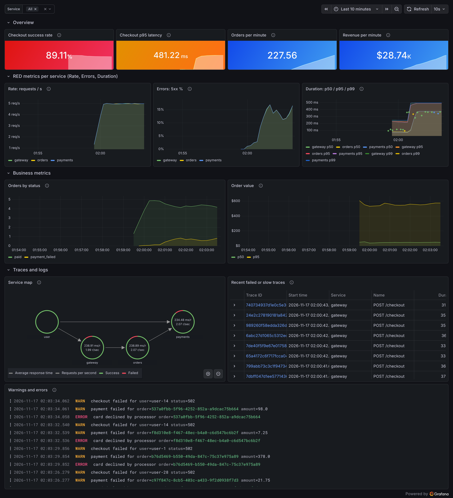
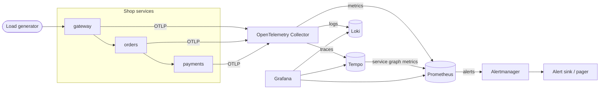
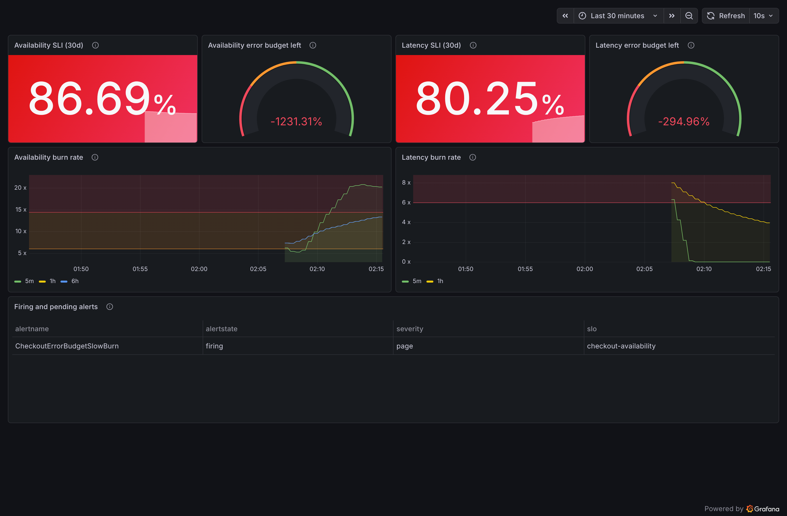

# Observability Platform

[](https://github.com/MITRAKER/observability-platform/actions/workflows/ci.yml)
[](https://github.com/MITRAKER/observability-platform/actions/workflows/codeql.yml)
[](https://github.com/MITRAKER/observability-platform/releases)
[](https://www.python.org/)
[](LEARNING.md#step-5-professional-code-quality-and-ci)
[](https://github.com/astral-sh/ruff)
[](https://mypy-lang.org/)
[](LICENSE)

A production-style observability platform for a microservice shop:
OpenTelemetry instrumentation, metrics in Prometheus, traces in Tempo, logs in
Loki, everything correlated in Grafana, with SLOs, burn-rate alerting, chaos
scenarios, and a CI/CD pipeline held to the NASA/JPL "Power of Ten" coding rules.



## Highlights

- **Three signals, one click apart:** metric exemplar → trace → logs → back to the trace.
- **Service map discovered from real traffic** by Tempo's metrics generator.
- **SLOs with multi-window, multi-burn-rate alerts** (Google SRE Workbook), unit-tested with `promtool`.
- **Chaos scenarios** (`flaky`, `slow`, `outage`) that make the alerts fire for real.
- **Professional engineering:** strict typing, 99% test coverage, security scanning, config validation, a full-stack e2e test in CI, and automated releases.
- **[LEARNING.md](LEARNING.md):** every design decision explained, step by step, with exercises.

## Architecture



## Run it

```bash
docker compose up --build
```

| What | Where |
|---|---|
| Grafana (dashboard: Shop > Shop overview) | http://localhost:3000 |
| Prometheus (alerts at /alerts) | http://localhost:9090 |
| Alertmanager | http://localhost:9093 |
| Shop gateway API | http://localhost:8080/docs |
| Payments chaos switch | http://localhost:8082/docs |

Cause an incident and watch the SLO alerts fire:

```bash
./scripts/chaos.sh flaky          # or: slow, outage, healthy
docker compose logs -f alert-sink # the "pager"
```



## Development

```bash
pip install -r requirements-dev.txt
ruff check . && ruff format --check . && pytest --cov
```

See [LEARNING.md, step 5](LEARNING.md#step-5-professional-code-quality-and-ci) for the full list of checks.

## Roadmap

- [x] Step 1: Three services, load generator, Docker Compose
- [x] Step 2: OpenTelemetry instrumentation and Collector
- [x] Step 3: Prometheus, Tempo, Loki and Grafana dashboards
- [x] Step 4: SLOs, burn-rate alerts with unit tests, Alertmanager, chaos scenarios, runbooks
- [x] Step 5: CI (lint, strict types, tests with 99% coverage, security scans, config validation, end-to-end smoke test) and NASA/JPL Power of Ten rules
- [x] Step 6: Release automation (images on GHCR), Dependabot, pre-commit, templates, architecture diagram

See [CHANGELOG.md](CHANGELOG.md) for release notes and [CONTRIBUTING.md](CONTRIBUTING.md) to contribute.
